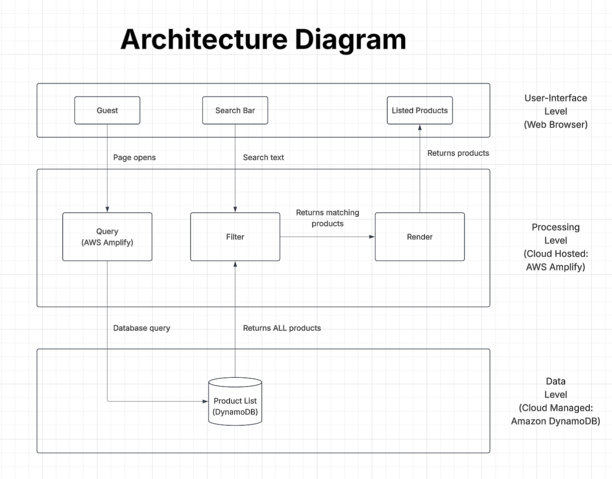

## CSC131 Shopping Website Prototype
This is a prototype for our CSC131 group project at California State University, Sacramento. This is an online shopping website for a single retailer. This prototype covers two main features which is **searching products** and **displaying products**.

A visitor will open the website and see a product list which is loaded from the cloud database and can narrow their options by typing in the search bar.

## Architecture Diagram


## Prototype Information and Goal
The goal of this prototype is to show all three tiers of a system that work together given the architectural design.
| Tier | Defined in this project prototype |
|---|---|
| Frontend (User Interface) | React + Vite; the search bar and product listings |
| Processing | The page's query, filter, and render logic using AWS Amplify |
| Backend (Data) | Amazon DynamoDB table `Product` which is defined with AWS Amplify |

Likewise, the entire prototype app is deployed on AWS Amplify.

## How it works

```
Start:
Page opens -> Queries DB to get the Product List -> List is filtered -> Filtered list is rendered

Search:
Type text -> Filters the list that is already loaded on the page (This is not a DB query) -> re-render filtered list
```

## UI Tier
- **src**: stores the files for running the frontend features
  - App.css: this CSS file contains code for visual design in App.tsx 
  - App.tsx: this TypeScript file is for developing the main page of the website
  - Product.css: this CSS file contains code for describing the visual design of a product card in Product.tsx
  - Product.tsx: this TypeScript file contains a template code for creating a a product card
  - index.css: empty file filled with comments.
  - main.tsx: This file is for importing all the necessary TypeScript and CSS files to deploy the UI
 
## Processing Tier
- **amplify**: stores files for running the backend features
  - **data**
    - resource.ts: this file has the base code for creating a NoSQL schema
  - backend.ts

## Database Tier
- **database**
  - server.js: this file contains the code for connecting to a local database and executing SQL queries
  - package.json
  - package-lock.json

## Development Tools
- **React** for the framework and frontend development
- **Vite** for the production builds
- **AWS Amplify** for hosting and Data handling
- **Amazon DynamoDB** for product storage
- **GitHub** for the version control with branches and pull requests
- **Lucid** to make and design the Architecture Diagram
- **Figma** for the UI prototype design
- **Visual Studio Code** as an IDE and a code editor
- **Node.js** as runtime environment for running a server in JavaScript
- **NPM (Node Package Manager)** as a package manager for installing library tools to improve JavaScript code in web development

## Database Tools
- **MySQL**: A relational database management system (RDBMS) for storing and processing data in a table of rows and columns
- **MySQL Workbench**: A database IDE for writing SQL query codes to set up and manipulate the MySQL database and tables

## Database and Cryptography Libraries in NPM
- **mysql2**: This library in Node Package Manager provides accessibility that allows the JavaScript codes to connect to and query from a local MySQL database. Functions:
  - createPool(databaseInfo): this function allows JavaScript to connect with a local database and manages multiple connections which allows several queries to run simultaneously  
  - query(query): this function allows JavaScript to send a query directly to the database and returns a value in a JSON format
- **bcrypt**: This library in Node Package Manager allows JavaScript to hash a password and compare plain text password with a stored hash password. Functions:
  - hashSync(data, salt): this function hash the data parameter and returns a hash value as a string variable
  - compareSync(data, encryptedData): this function compares data with encryptedData parameters and returns true if they match

## SQL Constraint Syntaxes
- **PRIMARY KEY**: set a field in the table as a primary key and is automatically set as a unique key
- **FOREIGN KEY**: set a field in the table as a foreign key
- **UNIQUE**: set a field in the table as a unique key
- **NOT NULL**: set a field in the table to prevent having an empty value
