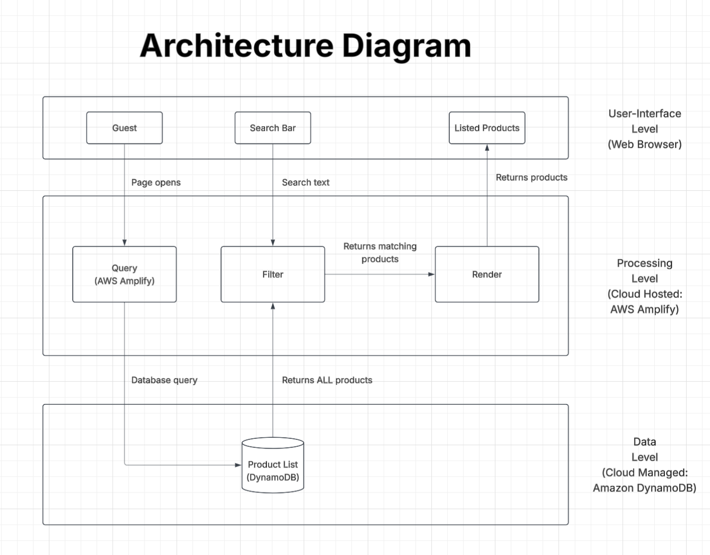

## CSC131 Shopping Website Prototype
This is a prototype for our CSC131 group project at California State University, Sacramento. This is an online shopping website for a single retailer. This prototype covers two main features which is **searching products** and **displaying products**.

A visitor will open the website and see a product list which is loaded from the cloud database and can narrow their options by typing in the search bar.

## Architecture Diagram


## Prototype Goal
The goal of this prototype is to show all three tiers of a system that work together given the architectural design.
| Tier | Defined in this project prototype |
|---|---|
| Frontend (User Interface) | React + Vite; the search bar and product listings |
| Processing | The page's query, filter, and render logic using AWS Amplify |
| Backend (Data) | Amazon DynamoDB table `Product` which is defined with AWS Amplify |

Likewise, the entire prototype app is deployed on AWS Amplify.

## How it works

```
Start:
Page opens -> Queries DB to get the Product List -> List is filtered -> Filtered list is rendered

Search:
Type text -> Filters the list that is already loaded on the page (This is not a DB query) -> re-render filtered list
```

## Development Tools
- **React** for the framework and frontend development
- **Vite** for the production builds
- **AWS Amplify** for hosting and Data handling
- **Amazon DynamoDB** for product storage
- **GitHub** for the version control with branches and pull requests
- **Lucid** to make and design the Architecture Diagram
- **Figma** for the UI prototype design
- **VSCode** as an IDE
